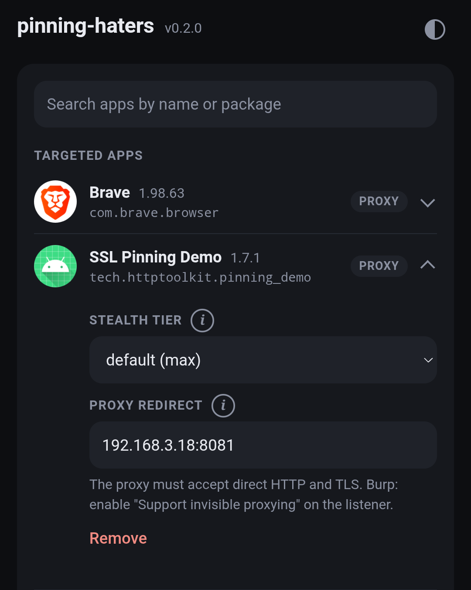
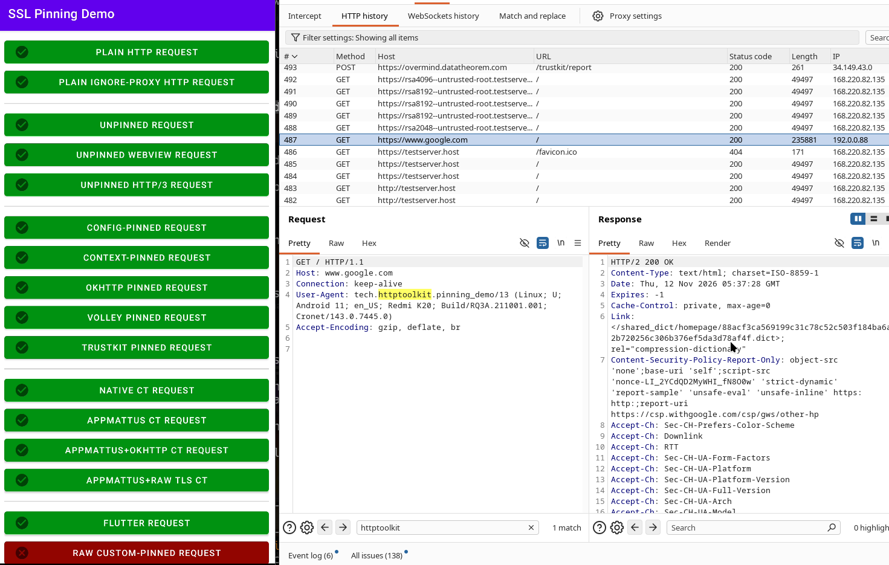

# pinning-haters

See what an Android app sends over HTTPS, even when it pins its certificates.
Install the module, pick the app, point it at your proxy.

<p align="center">
  
  &nbsp;&nbsp;
  
</p>

pinning-haters is a Zygisk module that turns off certificate pinning in the apps you choose.

## Why this one

- **Nothing to script or rebuild.** No Frida, no patched APK, no Xposed framework. You pick apps
  from a list on the phone, and the choice survives reboots.
- **Quiet by default.** It changes no executable code in the app. It rewrites pointers in data
  pages and patches the app's own DEX while Android verifies it, so a check that compares a
  library's code in memory with the file on disk finds nothing.
  [How that works](docs/detection-model.md).
- **Covers what apps really use.** Platform trust and Network Security Config pins, custom
  `TrustManager`s, TrustKit, OkHttp `CertificatePinner`, WebView, Flutter, and OpenSSL or BoringSSL
  bundled inside the app.
- **Brings the traffic to your proxy.** Flutter and most native code ignore the system proxy.
  Give such an app a proxy address and its traffic goes there, from outside the app: no proxy
  setting or VPN on the phone, and no CA certificate to install.
- **Tells you what happened.** Each launch can write a log that names every pinning surface it
  found, whether it was reached, and what to change when it was not.

## Get started

1. **Install.** Download the zip from the
   [Releases page](https://github.com/morkin1792/pinning-haters/releases), flash it in your root
   manager and reboot once.
2. **Pick an app.** Open the module's page in KernelSU or APatch, search for the app, tap it and
   press Save. Nothing is touched until you add an app.
3. **Open the app.** Force-stop it first if it was running. No reboot is needed for this or for any
   later change.

If the app's traffic does not reach your proxy, open the app's entry on that page and fill in
**Proxy redirect** with your proxy's `ip:port`. The proxy must accept direct connections; in Burp
that is "Support invisible proxying" on the listener.
[Details](docs/reference.md#apps-that-ignore-the-system-proxy).

Magisk has no module pages, so there you write the same choices to
`/data/adb/pinning_haters/config.json` as root:

```json
{
  "version": 2,
  "packages": { "com.example.app": { "redirect": "192.168.1.10:8080" } },
  "log": { "enabled": true }
}
```

## What you need

- Android 11 to 16, arm64.
- Root with Zygisk: KernelSU or APatch with Zygisk Next, or Magisk 26 and later.

## What it does not do

- **Hide root.** That is [rootcheck-haters](https://github.com/morkin1792/rootcheck-haters);
  install both when an app checks for root.
- **Beat every protection.** An app with its own tamper detection can still notice the module or
  refuse to run. The default mode is quiet, not invisible; [docs/threat-model.md](docs/threat-model.md)
  says what detects it.
- **Reach every runtime.** Pinning written in Dart, Unity or Mono code, and checks backed by
  hardware, are out of reach today. The full list is in
  [docs/known-limitations.md](docs/known-limitations.md).

## Check that it worked

Turn on **Logs** on the module's page, open the app, and read the newest log there. From a shell:

```sh
adb shell su -c 'ls -t /data/adb/pinning_haters/log | head -1'
adb shell su -c 'cat /data/adb/pinning_haters/log/<file>' | grep coverage
```

`present=yes reachable=yes` means that surface was hooked. `present=yes reachable=no` gives the
reason and, when a louder mode would help, the tier to set for that one app. `present=no` is
normal: the app does not ship that library. Every line is explained in
[docs/coverage.md](docs/coverage.md).

## Status

**v0.2.0, pre-release (2026-11-12).** Verified on Android 11 (APatch + Zygisk Next) and Android 16
(KernelSU + Zygisk Next). The proxy redirect and the redesigned settings page have run on the
Android 11 device only. Android 12 to 15 and Magisk as a host are untested. The full record is in
[docs/android-versions.md](docs/android-versions.md).

## Documentation

| Document | Contents |
|---|---|
| [docs/reference.md](docs/reference.md) | How it works, hosts, every config key, log format, build and test commands. |
| [docs/coverage.md](docs/coverage.md) | The coverage log: every surface, every reason, what to change. |
| [docs/stealth-tiers.md](docs/stealth-tiers.md) | `max` / `balanced` / `compat` and the per-package override. |
| [docs/known-limitations.md](docs/known-limitations.md) | What is not and will not be reached. |
| [docs/testing.md](docs/testing.md) | Host tests, the manual matrix, the release check. |
| [docs/architecture.md](docs/architecture.md) | Components, wire protocol, the GOT edges, the DEX path. |
| [docs/detection-model.md](docs/detection-model.md) | The primitive ranking that decides every hook. |
| [docs/threat-model.md](docs/threat-model.md) | Who this is for and what detects it. |
| [docs/android-versions.md](docs/android-versions.md) | Verification record per API level and device. |
| [docs/adding-hooks.md](docs/adding-hooks.md) | Hooks are data: adding a target. |
| [AGENTS.md](AGENTS.md) | Decision log for contributors. |
| [CHANGELOG.md](CHANGELOG.md), [DISCLAIMER.md](DISCLAIMER.md) | Release history, terms of use. |

## License

GPL-3.0-or-later. See `LICENSE`. The vendored `nlohmann/json` header (`module/jni/config/json.hpp`)
is MIT.
